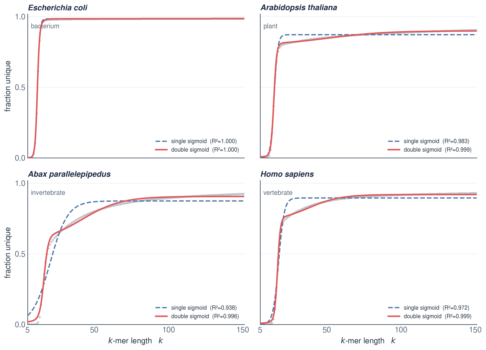

# k-plexity

**k-plexity is the fraction of unique *k*-mers in a genome assembly, as a function of *k*.**

For each *k*, `kplex` counts the distinct *k*-mers in the assembly (`U`) and the total number of
*k*-mers (`T`); the curve is `U/T` over *k* = 5–151. It uses the assembly only — no reads, no
annotation — and is summarised by a fit with five interpretable parameters: how much of the assembly can
ever become unique, how much sits in diverged repeat copies, and how diverged those copies are.


Bacteria rise once, at the length where random collisions stop; eukaryotes, with their repeat content, keep
rising as *k* grows long enough to tell diverged repeat copies apart:



---

## Install

```bash
git clone --recursive https://github.com/jacgonisa/kplexity.git
cd kplexity
pip install -e .
```

That gives you the **`kplex`** command. The *k*-mer counting is done by a small separate
binary — build the bundled one once and point `kplex` at it:

```bash
make -C FASTK          # builds FastK, Histex and Kplex (Kplex calls the other two)
export KPLEX_BIN=$PWD/FASTK/Kplex
#   (or use KMC instead:  conda install -c bioconda kmc  →  --tool kmc)
```

---

## Three commands

```bash
kplex run   genome.fa    #  FASTA  → curve        (.kplex.csv)
kplex fit   curve.csv    #  curve  → parameters   (.fit.json)
kplex plot  curve.csv    #  curve  → figure       (.png)
```

…or all three at once:

```bash
kplex run genome.fa -o mygenome --chromosomes-only --fit --plot -T 20
#  → mygenome.kplex.csv, mygenome.fit.json, mygenome.png
```

Handy flags: `-k 5:151:1` (k range, or a comma list), `-T` (threads), `--chromosomes-only`
(keep chromosome-scale sequences), `--tool fastk|kmc`, `--sketch` (below).

### Sketching: 15 k values instead of 147

Each value of *k* is one counting pass, so the full ladder is the slow part. `--sketch` counts only `N` values
(default 15): an even grid over 5–151 plus six values across the first rise, placed from the genome size
(k ≈ 1.213·log₄G − 1.95 ± 5), and `kplex fit` weights the uneven points by the span each one stands for.

```bash
kplex run genome.fa --sketch --fit          # 15 k values
kplex run genome.fa --sketch 25 --fit       # more k, less drift
kplex schedule --genome-bp 3.1e9            # print the k list (to pass to Kplex -k yourself)
```

Across 326 annotated DToL genomes, 15 sketched values reproduce the full-ladder parameters with a median drift
of 1.8% (15 evenly spaced values: 12.9%). On T2T-CHM13 (3.1 Gb, 20 threads) the 15-value sketch took 8 min against
54 min for all 147 values, and its fit drifts 0.9% from the full one. Fewer than about 12 values is not reliable.

---

## The fit

```
y(k) = B(k) · [A − S · e^(−λ(k − k0))]        B(k) = (1 − e^(−L)) / L,   L = 2·e^(−b(k − k0))
```

Three things make a *k*-mer non-unique, and each has a term:

1. **Chance collisions.** `B(k)` is the exact curve of a random sequence when `b = ln 4` and `k0 = log₄(G)`:
   short *k*-mers recur by chance; past `k0` they stop.
2. **Diverged repeat copies.** A *k*-mer in a copy that differs from the others at a fraction `δ` of sites is
   shared until it spans a difference, with probability `(1 − δ)^k`. Summed over copies this gives the
   near-copy gap `S · e^(−λ(k − k0))`, which closes as *k* grows.
3. **Identical copies.** Copies that no *k* ≤ 151 can separate (homogeneous tandem arrays, rDNA, recent
   duplications) keep the curve below one: the plateau `A`.

| parameter | name | what it is |
|---|---|---|
| `A` | resolvable fraction | the plateau; `1 − A` is the **identical-copy fraction** |
| `S` | near-copy share | share of *k*-mers at `k0` that sit in diverged repeat copies (tracks transposable-element content) |
| `λ` | decay rate | how fast those copies resolve; **divergence** between copies = `1 − e^(−λ)` |
| `k0` | first-rise position | ≈ log₄(genome size), an internal check on every fit |
| `b` | first-rise steepness | `ln 4` ≈ 1.39 for random sequence |

```bash
kplex fit curve.csv                   # the model above (default)
kplex fit curve.csv --model gamma     # + one parameter a: divergence varies across copies
```

`kplex fit` writes the parameters to a `.fit.json` with `R²`, `RMSE` and `AICc`. It reads the genome size
from the curve's `total_kmers` column to start `k0` at log₄(G) (or give `--genome-bp`). If the near-copy gap is
still open at the largest *k* (very homogeneous repeats), `A` is an extrapolation and `kplex fit` says so
(`"plateau_reached": false`).

**Why the near-copy term.** A model with chance collisions and a plateau only (`B(k) · A`, three parameters)
leaves a systematic residual of exactly the shape `S · e^(−λk)`. Adding the term lowers the error in all 323 DToL
genomes tested (median 12-fold, by an amount that grows with `S`; lower AICc in every one) and predicts the curve
beyond the fitted range better in every one.

---

## Explore a curve in the browser

**[jacgonisa.github.io/kplexity](https://jacgonisa.github.io/kplexity/)** fits a k-plexity curve and
shows it against 323 chromosome-level Darwin Tree of Life genomes with repeat annotation (median and 50% / 90%
bands per clade, adjustable opacity; plants, vertebrates, invertebrates, fungi). Example curves are built in (Arabidopsis,
human, barley, a ladybird, an oyster mushroom and *E. coli*), and the page has a light and a dark theme. Drop in the `.kplex.csv` from `kplex run` (or any `k, fraction`
table); the fit runs in your browser and nothing is uploaded. You get the fitted parameters, where each one falls
within each clade, and any of these species overlaid by name. A "Reading the parameters" tab shows, for each parameter,
the evidence behind its interpretation (reference genomes and simulations). The page does not count *k*-mers itself;
use `kplex run` for that.

---

## Acknowledgements

- The original idea for k-plexity is **Katie Jenike's**.
- The core *k*-mer counting is done by **[FASTK](https://github.com/thegenemyers/FASTK)**
  (Gene Myers); `kplex` wraps `FASTK`/`Kplex` (bundled here as a submodule).
- **Claude** was used in this project (mainly in the k-plexity animation, benchmarking automatization and in
  the `kplex` command-line interface). The core counting code comes from **FASTK**.

---

## Layout

```
kplex/        the CLI (run / fit / plot)
FASTK/        the k-mer counter  (git submodule → jacgonisa/FASTK; wraps FASTK by Gene Myers)
assets/       figures
animation/    the explainer
docs/         the browser explorer (GitHub Pages)
```

**Contact:** Jacob Gonzalez · [github.com/jacgonisa](https://github.com/jacgonisa)
